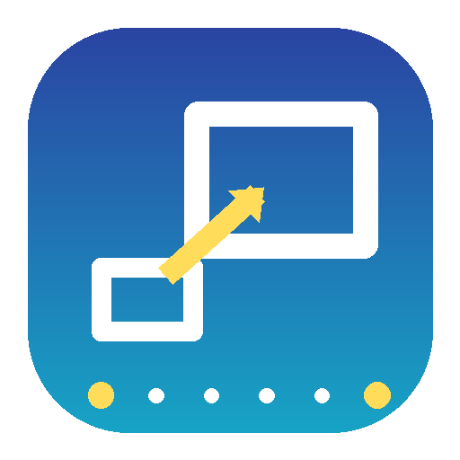

# RelayVSR Studio

Windows desktop video upscaler built on **[RelayVSR](https://kopperx.github.io/RelayVSR/)**
(*Large–Small Model Collaboration for Efficient Real-World Video Super-Resolution*,
Wang et al., USTC, arXiv:2609.37850), tuned for NVIDIA RTX 50-series GPUs such as the
RTX 5070 Ti while remaining usable on 8–24 GB RTX 20/30/40 cards.

[한국어 안내는 아래](#한국어)

<p align="center"></p>

## How RelayVSR works (and what this app adds)

RelayVSR is a *streaming* video super-resolution system made of two networks:

* a **large one-step generative keyframe model** (a 5B-parameter Wan 2.2 transformer,
  `wan.safetensors`, 10 GB) that produces a reference latent for every 15th frame, and
* a **lightweight Flash decoder** (32M parameters, `flash.safetensors`) that upscales
  *every* frame while attending to the two surrounding keyframe references plus one
  frame of history ("dual-endpoint conditioning with bounded lookahead").

Because the expensive model only runs on sparse keyframes, RelayVSR reaches 29 FPS at
1080p output on an A100 while using about half the memory of FlashVSR-Tiny.

RelayVSR Studio wraps the official inference code in a Windows application and adds:

| Feature | Why |
|---|---|
| Native **4x** (`kopper/RelayVSR`) and **2x** (`lightx2v/RelayVSR_X2`) checkpoints | 2x is ~3.6x faster for 1080p → 4K |
| **FP8 (E4M3) weight-only storage** of the Wan transformer | 10 GB → 5 GB VRAM, native on Blackwell/Ada |
| **CPU block offload** of the Wan transformer (pinned memory, prefetching) | 8–12 GB GPUs |
| **Spatial tiling** of the keyframe model with parked KV caches | any resolution within a fixed VRAM budget |
| **Triton fused local-attention kernels on Windows** (triton-windows) with an exact **SDPA fallback** | speed with Triton, portability without |
| NVML-based VRAM planner | avoids the silent WDDM system-memory fallback that makes CUDA crawl on Windows |
| PySide6 GUI: queue, drag & drop, before/after previews, progress/ETA/VRAM, Korean/English | |
| Encoders: libx264 / libx265 / NVENC (H.264, HEVC, AV1), CRF control, audio stream copy | |
| Output size presets (native, fit 1080p/1440p/4K, custom width), detail-strength control | |
| Installer that keeps the GUI small; PyTorch CUDA 12.8 + Triton are installed on first run | GitHub release assets stay under 100 MB |

## Requirements

* Windows 10 1809+ / Windows 11, 64-bit
* NVIDIA GPU with a driver supporting CUDA 12.8 (R570+). Tested on an RTX 5070 Ti (16 GB,
  Blackwell sm_120). RTX 20/30/40 series work too (FP8 storage is emulated on pre-Ada GPUs).
* 8 GB VRAM minimum (block offload + tiling), 16 GB recommended, 24 GB for full BF16 quality.
* ~25 GB of free disk: 3.5 GB engine (PyTorch, Triton, FFmpeg via PyAV) + 10 GB per model.
* 16 GB system RAM (32 GB recommended when block offload is used).

## Install

1. Download `RelayVSR-Studio-Setup-<version>.exe` from the
   [Releases](https://github.com/yunhyok/relayvsr-studio/releases) page and run it (no admin
   rights needed; it installs per user).
2. Launch **RelayVSR Studio**. On first start it offers to install the inference engine
   (PyTorch 2.10 CUDA 12.8, triton-windows, PyAV …) into `%LOCALAPPDATA%\RelayVSRStudio\env`.
3. Open **Environment** and download the model(s) you want (4x and/or 2x, ~10 GB each).
   Downloads resume if interrupted; folders can be moved to another drive from the same dialog.
4. Drop videos onto the queue, pick the model and output size, press **Start**.

The app never bundles the model weights; they are downloaded from Hugging Face on demand.

## Which model / settings?

| Input | Target | Model | Typical on RTX 5070 Ti (16 GB) |
|---|---|---|---|
| 480p / 540p | 1080p–2160p | 4x | FP8 weights, full-frame keyframes |
| 720p | 1440p | 2x | FP8, full-frame keyframes |
| 1080p | 4K | 2x | FP8 + 2 keyframe tiles (planner picks automatically) |
| 1080p | 4K | 4x then "Fit 4K" | slower; 4x model computes 4320p internally |

The **Auto** VRAM strategy measures free VRAM with NVML and picks the cheapest configuration
that fits: BF16 → FP8 → FP8 + tiling → + block offload. Override it under *Advanced*.

Performance tips for Blackwell cards: keep Triton enabled (default; the status line shows
`Triton ✓`), close other GPU-heavy applications (on Windows the driver pages CUDA memory to
system RAM instead of failing, which slows inference by 10–100x), and prefer NVENC encoders
for 4K output so encoding never becomes the bottleneck.

## Command line

The managed environment also provides a CLI (useful for scripting):

```bash
%LOCALAPPDATA%\RelayVSRStudio\env\Scripts\python.exe -m relayvsr_studio.cli upscale -i input.mp4 -o output.mp4 --scale 4
```

```bash
python -m relayvsr_studio.cli upscale -i clip.mp4 -o clip_4k.mp4 --scale 2 --codec hevc_nvenc --crf 20 --prefer low_vram
```

Other commands: `probe` (GPU / encoder / media info as JSON), `download --scale 2|4`,
`gui`. Run `python -m relayvsr_studio.cli upscale -h` for all options (tiling, FP8, offload,
KV window, keyframe interval, detail strength, frame ranges, image sequences, PNG output).

## Building from source

```bash
git clone https://github.com/yunhyok/relayvsr-studio
cd relayvsr-studio
uv venv .venv --python 3.12 && .venv\Scripts\activate
uv pip install torch==2.10.0 --index-url https://download.pytorch.org/whl/cu128
uv pip install -r requirements/engine-cu128.txt PySide6-Essentials pytest
python -m relayvsr_studio.cli download --scale 4
python -m relayvsr_studio.app.main        # GUI (uses the current interpreter as engine)
pytest -q                                 # unit tests incl. Triton-vs-SDPA equivalence on GPU
```

Installer: `powershell -ExecutionPolicy Bypass -File installer\build.ps1` (needs Inno Setup 6)
produces `build\installer\RelayVSR-Studio-Setup-<version>.exe`. The GitHub Actions workflow
builds the same artifact for every `v*` tag.

## Project layout

```
relayvsr_studio/
  engine/            inference engine (worker process)
    models/wan/      one-step Wan keyframe model (official code + backend hooks)
    models/flash/    Flash streaming decoder (official code, 2x/4x geometry)
    backends.py      Triton / tiled-SDPA local attention selection
    quant.py         FP8 weight-only linear layers
    offload.py       CPU block offload with prefetch
    gpu.py           GPU detection, NVML memory, VRAM planner, presets
    runtime/         streaming schedule (keyframes + Flash decode), tiling
    media.py         PyAV decode/encode, NVENC via PyAV or external ffmpeg, audio remux
    pipeline.py      job orchestration, previews, progress
    worker.py        JSON-lines protocol used by the GUI
  app/               PySide6 GUI (queue, settings, environment dialog, i18n)
  bootstrap/         managed environment (uv) and model downloads
installer/           PyInstaller spec, Inno Setup script, build.ps1
```

## License and credits

RelayVSR Studio is released under the Apache License 2.0. The model code is derived from the
official RelayVSR inference release (Apache-2.0) by Xijun Wang, Xin Li, Zirui Lang, Suhang
Yao, Haoran Li and Zhibo Chen; the SDPA fallback follows LightX2V. See
`THIRD_PARTY_NOTICES.md`. Model weights are published by their authors on Hugging Face
(`kopper/RelayVSR`, `lightx2v/RelayVSR_X2`); check their model cards for usage terms.

```bibtex
@misc{wang2026relayvsr,
  title={RelayVSR: Large-Small Model Collaboration for Efficient Real-World Video Super-Resolution},
  author={Xijun Wang and Xin Li and Zirui Lang and Suhang Yao and Haoran Li and Zhibo Chen},
  year={2026}, eprint={2609.37850}, archivePrefix={arXiv}, primaryClass={cs.CV}
}
```

---

## 한국어

**RelayVSR Studio**는 USTC의 RelayVSR(희소 키프레임을 생성하는 대형 Wan 2.2 모델 + 모든
프레임을 복원하는 경량 Flash 디코더) 논문 구현을 Windows 데스크톱 앱으로 만든 동영상
업스케일러입니다. RTX 5070 Ti(16 GB, Blackwell)에 맞춰 다음을 추가했습니다.

* Wan 트랜스포머 **FP8 가중치 저장**(10 GB → 5 GB), **CPU 블록 오프로드**, **키프레임 타일링**으로
  VRAM 예산 안에서 임의 해상도 처리
* Windows용 **Triton 융합 로컬 어텐션 커널**(triton-windows) + Triton이 없을 때의 정확한 SDPA 대체 경로
* NVML 기반 VRAM 플래너(다른 앱이 VRAM을 쓰는 상황을 반영, WDDM 시스템 메모리 폴백 회피)
* 4배(`kopper/RelayVSR`)·2배(`lightx2v/RelayVSR_X2`) 모델, 출력 크기 프리셋, NVENC 인코딩, 오디오 복사
* 한국어/영어 GUI, 작업 대기열, 드래그 앤 드롭, 입력/출력 미리보기, 진행률·ETA·VRAM 표시

### 설치와 사용

1. [Releases](https://github.com/yunhyok/relayvsr-studio/releases)에서 `RelayVSR-Studio-Setup-<버전>.exe`를 받아 실행합니다(관리자 권한 불필요).
2. 앱을 처음 실행하면 추론 엔진(PyTorch CUDA 12.8 등 약 3.5 GB)을 `%LOCALAPPDATA%\RelayVSRStudio\env`에 설치할지 묻습니다.
3. **환경** 창에서 4배/2배 모델(각 약 10 GB)을 내려받습니다. 폴더는 다른 드라이브로 바꿀 수 있습니다.
4. 동영상을 대기열에 끌어다 놓고 모델과 출력 크기를 고른 뒤 **시작**을 누릅니다.

권장: 480p→1080p/4K는 4배 모델, 720p→1440p와 1080p→4K는 2배 모델. VRAM 전략은 **자동**이
가장 안전하며, 고급 옵션에서 FP8/BF16, 타일링, 오프로드, Triton/SDPA, 키프레임 간격 등을 바꿀 수 있습니다.
Windows에서는 다른 프로그램이 VRAM을 많이 쓰면 CUDA가 시스템 메모리로 넘쳐 매우 느려지므로,
업스케일 중에는 GPU를 쓰는 다른 앱(LLM 서버, 게임 등)을 닫는 것이 좋습니다.
